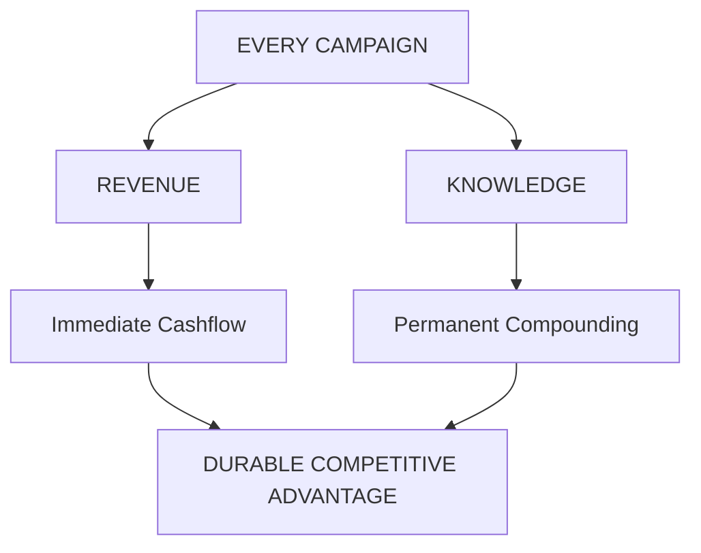
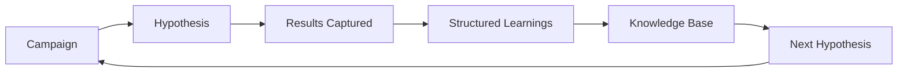
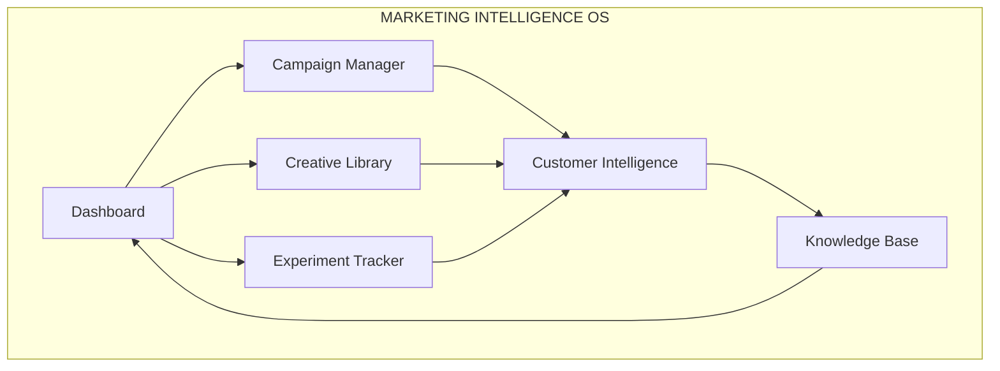
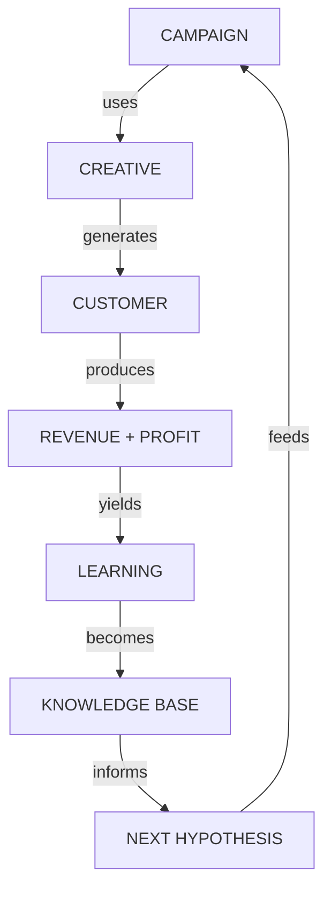
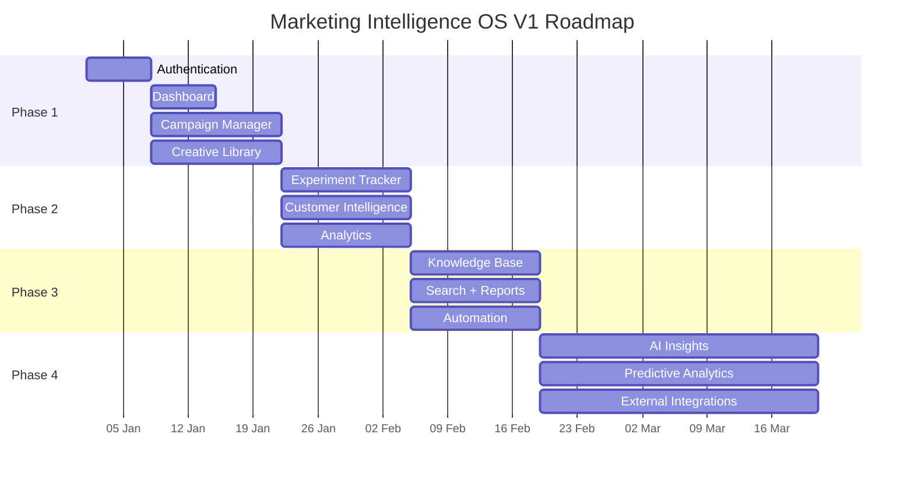

# MARKETING INTELLIGENCE OS
## Product Requirements Document — V1.0 (MVP)

```
┌─────────────────────────────────────────────────────────────────────────────┐
│                                                                             │
│   M A R K E T I N G   I N T E L L I G E N C E   O S                         │
│                                                                             │
│   From advertising company → Learning company                               │
│                                                                             │
│   Owner          : Hridesh Joshi (CEO)                                      │
│   Primary Users  : Riya (CMO) · CEO                                         │
│   Status         : MVP                                                      │
│   Version        : 1.0                                                      │
│                                                                             │
└─────────────────────────────────────────────────────────────────────────────┘
```

---

## 1. Vision & Core Philosophy

> **Every rupee spent should increase the company's knowledge.**  
> The platform becomes the single source of truth for all marketing intelligence.



**Success is measured by one question only:**

```
┌────────────────────────────────────────────────────────────┐
│                                                            │
│         Is Eradicant smarter after this campaign?          │
│                                                            │
└────────────────────────────────────────────────────────────┘
```

---

## 2. The Problem → The Solution

### Current State — Broken Loop

```
  Marketing Knowledge
         │
         ▼
  ┌─────────────┐     ┌─────────────┐     ┌─────────────┐
  │  In heads   │     │  Forgotten  │     │  Repeated   │
  │  of people  │────▶│  after time │────▶│  mistakes   │
  └─────────────┘     └─────────────┘     └─────────────┘
         │
         ▼
   No compounding · No institutional memory
```

### Desired State — Compounding Intelligence Loop



```
  Campaign launched
         │
         ▼
  ┌─────────────┐
  │  Hypothesis │
  └──────┬──────┘
         │
         ▼
  ┌─────────────┐     ┌─────────────┐     ┌─────────────┐
  │   Results   │────▶│  Learnings  │────▶│  Knowledge  │
  │  captured   │     │  structured │     │   Base      │
  └─────────────┘     └─────────────┘     └──────┬──────┘
         │                                       │
         └───────────────────────────────────────┘
                        compounds forever
```

---

## 3. Success Metrics

### Business Outcomes

| Metric                        | Target Direction       |
|-------------------------------|------------------------|
| Marketing ROI                 | ↑ Month-over-month     |
| Customer Acquisition Cost     | ↓ Steadily             |
| Creative production           | Fully evidence-driven  |
| Repeat mistakes               | → Approaching zero     |

### Product Completeness Targets

```
┌──────────────────────────────────────────────────────────┐
│                                                          │
│   100%  of campaigns documented                          │
│   100%  of creatives permanently stored                  │
│   100%  of learnings captured                            │
│                                                          │
└──────────────────────────────────────────────────────────┘
```

---

## 4. System Architecture Overview



```
┌─────────────────────────────────────────────────────────────────────────────┐
│                     MARKETING INTELLIGENCE OS                               │
│                                                                             │
│  ┌─────────────┐  ┌─────────────┐  ┌─────────────┐  ┌─────────────┐        │
│  │  DASHBOARD  │  │  CAMPAIGNS  │  │  CREATIVES  │  │ EXPERIMENTS │        │
│  │  CEO Home   │  │  Manager    │  │  Library    │  │  Tracker    │        │
│  └──────┬──────┘  └──────┬──────┘  └──────┬──────┘  └──────┬──────┘        │
│         │                │                │                │               │
│         └────────────────┴────────────────┴────────────────┘               │
│                                  │                                         │
│                                  ▼                                         │
│                    ┌─────────────────────────┐                             │
│                    │   CUSTOMER INTELLIGENCE │                             │
│                    └────────────┬────────────┘                             │
│                                 │                                          │
│                                 ▼                                          │
│                    ┌─────────────────────────┐                             │
│                    │     KNOWLEDGE BASE      │                             │
│                    │   Institutional Memory  │                             │
│                    └─────────────────────────┘                             │
└─────────────────────────────────────────────────────────────────────────────┘
```

---

## 5. Core Data Flow — The Intelligence Chain

Every action must flow into permanent knowledge. No isolated records.



```
  CAMPAIGN
      │
      │  uses
      ▼
  CREATIVE
      │
      │  generates
      ▼
  CUSTOMER
      │
      │  produces
      ▼
  REVENUE + PROFIT
      │
      │  yields
      ▼
  LEARNING
      │
      │  becomes
      ▼
  KNOWLEDGE BASE
      │
      │  informs
      ▼
  NEXT HYPOTHESIS
```

---

## 6. MVP Modules Deep Dive

### Module 1 — Campaign Manager

**Purpose:** Track every campaign from hypothesis to results.

```
┌────────────────────────────────────────────────────────────┐
│  CAMPAIGN RECORD                                           │
├────────────────────────────────────────────────────────────┤
│  Identity                                                  │
│  • Campaign Name · Campaign ID · Platform · Objective      │
│  • Launch / End Date · Status · Owner                      │
│                                                            │
│  Targeting & Offer                                         │
│  • Target Audience · Service · Pest Type · Location        │
│  • Offer · CTA · Landing Destination                       │
│                                                            │
│  Creative                                                  │
│  • Creative Used (linked to Creative Library)              │
│                                                            │
│  Performance (auto-calculated)                             │
│  • Reach · Impressions · CTR · CPM · CPC                   │
│  • Messages · Calls · Qualified Leads · Site Visits        │
│  • Quotes · Customers · Revenue · Gross / Net Profit       │
│  • ROAS · CAC                                              │
│                                                            │
│  Reflection (the most important section)                   │
│  • Hypothesis · Result · What Worked · What Failed         │
│  • Lessons · Next Experiment · Confidence                  │
└────────────────────────────────────────────────────────────┘
```

**Actions available:** Create · Edit · Archive · Duplicate

---

### Module 2 — Creative Library

**Purpose:** Permanent storage of every creative ever produced.

```
┌────────────────────────────────────────────────────────────┐
│  CREATIVE ASSET                                            │
├────────────────────────────────────────────────────────────┤
│  Media          : Thumbnail · Video · Image                │
│  Copy           : Hook · Headline · Body · CTA · Offer     │
│  Psychology     : Emotion · Psychological Principle        │
│  Context        : Audience · Pest · Platform · Campaign    │
│  Performance    : CTR · CPC · Messages · Customers         │
│                   Revenue · Profit · ROAS · Rating         │
│  Learning       : Why it worked · Why it failed            │
│                   Future improvements                      │
└────────────────────────────────────────────────────────────┘
```

**Search Filters:**  
Platform · Emotion · Offer · Audience · Service · Hook · Performance · Date

---

### Module 3 — Experiment Tracker

**Purpose:** Marketing must operate like science.

```
┌────────────────────────────────────────────────────────────┐
│  EXPERIMENT CARD                                           │
├────────────────────────────────────────────────────────────┤
│  Question          →  Do fear-based hooks outperform       │
│                       educational hooks?                   │
│  Hypothesis        →  Fear will generate higher CTR        │
│  Variable Tested   →  Creative                             │
│  Control / Variant →  Educational  vs  Fear                │
│  Expected Outcome  →  +20% CTR on fear                     │
│  Result            →  Fear won                             │
│  Decision          →  Scale fear hooks                     │
│  Confidence        →  High                                 │
│  Next Experiment   →  Fear + specific pest type            │
└────────────────────────────────────────────────────────────┘
```

---

### Module 4 — Customer Intelligence

**Purpose:** Every customer teaches the company something.

```
┌────────────────────────────────────────────────────────────┐
│  CUSTOMER PROFILE                                          │
├────────────────────────────────────────────────────────────┤
│  Identity          : Name · Phone · Location · Property    │
│  Source            : Lead Source · Campaign · Creative     │
│  Economics         : Revenue · Profit · LTV                │
│  Psychology        : Why contacted · Biggest fear          │
│                      Biggest objection · Why chose us      │
│                      What built trust · Questions asked    │
│  Future            : Review · Referral · AMC Opportunity   │
└────────────────────────────────────────────────────────────┘
```

---

### Module 5 — Knowledge Base

**Purpose:** Permanent institutional memory.

```
┌─────────────────────────────────────────┐
│           KNOWLEDGE BASE                │
├──────────────────┬──────────────────────┤
│  Marketing       │  Sales               │
│  Operations      │  Treatment SOPs      │
│  Hiring          │  Pricing             │
│  Customer        │  Competitor Research │
│  Psychology      │                      │
│  Commercial      │  Residential         │
└──────────────────┴──────────────────────┘
```

---

### Module 6 — Dashboard (CEO Home Screen)

```
┌─────────────────────────────────────────────────────────────────────────────┐
│                           CEO DASHBOARD                                     │
├─────────────────────────────────────────────────────────────────────────────┤
│                                                                             │
│   TODAY                          THIS MONTH                                 │
│   ──────                         ──────────                                 │
│   Revenue                        Revenue                                    │
│   Leads                          Profit                                     │
│   Messages                       Marketing Spend                            │
│   Calls                          Pipeline                                   │
│   Jobs                           Commercial Opportunities                   │
│                                                                             │
│   CURRENT HEALTH                                                            │
│   ──────────────                                                            │
│   CAC · ROAS                                                                │
│                                                                             │
│   INTELLIGENCE                                                              │
│   ────────────                                                              │
│   Best Campaign · Worst Campaign · Top Creative · Recent Learnings          │
│                                                                             │
└─────────────────────────────────────────────────────────────────────────────┘
```

**The dashboard must automatically answer these questions:**

| Question                                      | Insight Type      |
|-----------------------------------------------|-------------------|
| What is our best performing campaign?         | Ranking           |
| Which offer converts best?                    | Comparative       |
| Which emotion converts best?                  | Pattern detection |
| Which pest has highest profit?                | Profitability     |
| Which audience gives highest LTV?             | Lifetime value    |
| What is increasing CAC?                       | Root cause        |
| What should we test next?                     | Recommendation    |

---

## 7. Navigation & Permissions

```
NAVIGATION STRUCTURE
────────────────────
Dashboard → Campaigns → Creatives → Experiments → Customers → Knowledge Base → Settings
```

| Role              | Access Level                            |
|-------------------|-----------------------------------------|
| CEO               | Full access (everything)                |
| CMO               | Everything except Settings              |
| Marketing Intern  | Campaigns + Creatives (no deletion)     |

---

## 8. Automation Layer

```
┌────────────────────────────────────────────────────────────┐
│  AUTOMATIC CALCULATIONS                                    │
│  CTR · CAC · ROAS · Conversion Rate · Revenue              │
│  Gross Profit · Net Profit                                 │
└────────────────────────────────────────────────────────────┘

┌────────────────────────────────────────────────────────────┐
│  AUTOMATIC LINKING                                         │
│                                                            │
│  Campaign ──▶ Creative ──▶ Customer ──▶ Revenue ──▶ Learning│
└────────────────────────────────────────────────────────────┘
```

---

## 9. Future AI Layer (Post-MVP)

```
┌────────────────────────────────────────────────────────────┐
│  AI SHOULD EVENTUALLY BE ABLE TO:                          │
│                                                            │
│  • Explain why Campaign 27 outperformed Campaign 18        │
│  • Suggest three new hooks                                 │
│  • Find common traits among winning creatives              │
│  • Generate the next hypothesis                            │
│  • Predict campaign performance                            │
│  • Detect creative fatigue                                 │
│  • Recommend budget allocation                             │
│  • Identify emerging customer objections                   │
│  • Generate weekly marketing reports automatically         │
└────────────────────────────────────────────────────────────┘
```

---

## 10. Non-Functional Requirements

| Requirement                  | Standard                  |
|------------------------------|---------------------------|
| Page load                    | < 2 seconds               |
| Responsive design            | Mobile-first              |
| Authentication               | Role-based                |
| Media support                | Image + Video uploads     |
| Search                       | Full-text across modules  |
| History                      | Version history for edits |
| Reliability                  | Automatic backups         |
| Export                       | CSV / Excel               |
| Theme                        | Dark mode supported       |
| Audit                        | Full audit logs           |

---

## 11. Design Principles

```
┌────────────────────────────────────────────────────────────┐
│                                                            │
│   Minimal UI              ·  Zero clutter                  │
│   Everything searchable                                    │
│   One-click navigation                                     │
│   Evidence over opinion                                    │
│   Learning over memory                                     │
│                                                            │
│   Every single page must answer:                           │
│   “What decision does this help us make?”                  │
│                                                            │
└────────────────────────────────────────────────────────────┘
```

---

## 12. V1 Roadmap



```
PHASE 1 (Weeks 1–2)          PHASE 2 (Weeks 3–4)
─────────────────────        ─────────────────────
• Authentication             • Experiment Tracker
• Dashboard                  • Customer Intelligence
• Campaign Manager           • Analytics
• Creative Library

PHASE 3 (Weeks 5–6)          PHASE 4 (Future)
─────────────────────        ─────────────────────
• Knowledge Base             • AI-powered insights
• Search                     • Predictive analytics
• Reports                    • Creative scoring
• Automation                 • Auto hypothesis generation
                             • Meta Ads API
                             • WhatsApp Business API
                             • CRM + Accounting integrations
```

---

## 13. Final Product Vision

```
┌─────────────────────────────────────────────────────────────────────────────┐
│                                                                             │
│   Marketing Intelligence OS becomes the institutional memory                │
│   of the company.                                                           │
│                                                                             │
│   Its purpose is not simply to record campaigns —                           │
│   it is to ensure that every experiment permanently increases               │
│   Eradicant’s ability to acquire customers more efficiently                 │
│   than its competitors.                                                     │
│                                                                             │
│   Every campaign, customer interaction, and operational insight             │
│   becomes structured knowledge that compounds over time                     │
│   into a durable competitive advantage.                                     │
│                                                                             │
└─────────────────────────────────────────────────────────────────────────────┘
```

---

```
━━━━━━━━━━━━━━━━━━━━━━━━━━━━━━━━━━━━━━━━━━━━━━━━━━━━━━━━━━━━━━━━━━━━━━━━━━━━━━
  END OF DOCUMENT · MARKETING INTELLIGENCE OS · V1.0 · CONFIDENTIAL
━━━━━━━━━━━━━━━━━━━━━━━━━━━━━━━━━━━━━━━━━━━━━━━━━━━━━━━━━━━━━━━━━━━━━━━━━━━━━━
```
