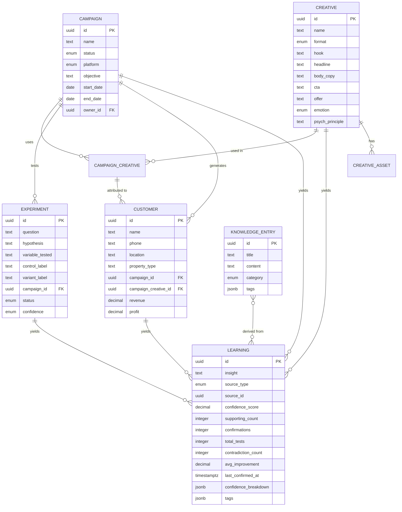

# Core Data Model — Marketing Intelligence OS (MVP)

> **Status:** ✅ LOCKED  
> **Approved:** 2026-07-30  
> **Derived from:** [Marketing_Intelligence_OS_PRD.md](file:///E:/MIOS/Marketing_Intelligence_OS_PRD.md)  
> **Confidence Algorithm:** [MVP_Confidence_Algorithm.md](file:///E:/MIOS/MVP_Confidence_Algorithm.md)

---

## Design Goals

1. **Every row tells a story** — Campaign → Creative → Customer → Revenue → Learning
2. **Nothing orphaned** — Every record links back to the intelligence chain
3. **Calculated fields are views, not stored** — CTR, CPC, ROAS etc. are computed, never manually entered (except raw inputs)
4. **Audit-ready from day one** — `created_at`, `updated_at`, `created_by`, `updated_by` on every table
5. **Supabase-native** — Uses Postgres features (enums, jsonb, RLS, triggers) directly
6. **Confidence is first-class** — Every Learning has a transparent, calculated confidence score (0–100)

---

## Entity Relationship Diagram



---

## Entity Definitions

### 1. `profiles`

User profiles extending Supabase Auth.

| Column | Type | Notes |
|--------|------|-------|
| `id` | `uuid` PK | Same as `auth.users.id` |
| `full_name` | `text` | |
| `role` | `enum` | `ceo`, `cmo`, `marketing_intern` |
| `avatar_url` | `text` | |
| `created_at` | `timestamptz` | |
| `updated_at` | `timestamptz` | |

---

### 2. `campaigns`

The central entity. Every marketing action starts here.

| Column | Type | Notes |
|--------|------|-------|
| `id` | `uuid` PK | Default `gen_random_uuid()` |
| `name` | `text` NOT NULL | e.g. "Termite Fear Hook – Jaipur" |
| `platform` | `enum` | `meta_ads`, `google_ads`, `whatsapp`, `organic_social`, `offline`, `other` |
| `objective` | `text` | Free-text campaign goal |
| `status` | `enum` | `draft`, `active`, `paused`, `completed`, `archived` |
| `start_date` | `date` | |
| `end_date` | `date` | |
| `owner_id` | `uuid` FK → `profiles.id` | Who owns this campaign |
| **Targeting & Offer** | | |
| `target_audience` | `text` | e.g. "Homeowners 30-50, Jaipur" |
| `service` | `text` | e.g. "Termite Treatment" |
| `pest_type` | `text` | e.g. "Termites" |
| `location` | `text` | City / area |
| `offer` | `text` | e.g. "Free Inspection" |
| `cta` | `text` | e.g. "WhatsApp Now" |
| `landing_destination` | `text` | URL or "WhatsApp" |
| **Raw Metrics (manual input)** | | |
| `spend` | `decimal(12,2)` | Total ₹ spent |
| `reach` | `integer` | |
| `impressions` | `integer` | |
| `clicks` | `integer` | |
| `messages` | `integer` | WhatsApp / DM count |
| `calls` | `integer` | |
| `site_visits` | `integer` | |
| `qualified_leads` | `integer` | |
| `quotes_sent` | `integer` | |
| `customers_won` | `integer` | |
| `revenue` | `decimal(12,2)` | Total revenue attributed |
| `cogs` | `decimal(12,2)` | Cost of goods / service delivery |
| **Reflection** | | |
| `hypothesis` | `text` | What we expected to learn |
| `result_summary` | `text` | What actually happened |
| `what_worked` | `text` | |
| `what_failed` | `text` | |
| `next_experiment` | `text` | What to test next |
| `confidence` | `enum` | `low`, `medium`, `high` (manual reflection confidence) |
| **Audit** | | |
| `created_at` | `timestamptz` | |
| `updated_at` | `timestamptz` | |
| `created_by` | `uuid` FK → `profiles.id` | |
| `updated_by` | `uuid` FK → `profiles.id` | |

**Calculated fields** (Postgres view `campaigns_with_metrics`):

| Field | Formula |
|-------|---------|
| `ctr` | `clicks / NULLIF(impressions, 0) × 100` |
| `cpm` | `spend / NULLIF(impressions, 0) × 1000` |
| `cpc` | `spend / NULLIF(clicks, 0)` |
| `cpl` | `spend / NULLIF(qualified_leads, 0)` |
| `cac` | `spend / NULLIF(customers_won, 0)` |
| `roas` | `revenue / NULLIF(spend, 0)` |
| `gross_profit` | `revenue - cogs` |
| `net_profit` | `revenue - cogs - spend` |
| `conversion_rate` | `customers_won / NULLIF(qualified_leads, 0) × 100` |

---

### 3. `creatives`

Every creative asset the company has ever produced.

| Column | Type | Notes |
|--------|------|-------|
| `id` | `uuid` PK | |
| `name` | `text` NOT NULL | Descriptive name |
| `format` | `enum` | `image`, `video`, `carousel`, `text_only`, `other` |
| `hook` | `text` | The opening line / visual hook |
| `headline` | `text` | |
| `body_copy` | `text` | |
| `cta` | `text` | Call to action text |
| `offer` | `text` | |
| `emotion` | `enum` | `fear`, `trust`, `urgency`, `curiosity`, `authority`, `social_proof`, `other` |
| `psych_principle` | `text` | e.g. "Loss aversion", "Social proof" |
| `target_audience` | `text` | |
| `target_pest` | `text` | |
| `target_platform` | `enum` | Same as campaign platform enum |
| `rating` | `integer` | 1-5 internal quality rating |
| `why_worked` | `text` | |
| `why_failed` | `text` | |
| `future_improvements` | `text` | |
| **Audit** | | |
| `created_at` | `timestamptz` | |
| `updated_at` | `timestamptz` | |
| `created_by` | `uuid` FK | |
| `updated_by` | `uuid` FK | |

---

### 4. `creative_assets`

Media files attached to a creative (stored in Supabase Storage).

| Column | Type | Notes |
|--------|------|-------|
| `id` | `uuid` PK | |
| `creative_id` | `uuid` FK → `creatives.id` | |
| `asset_type` | `enum` | `image`, `video`, `thumbnail` |
| `storage_path` | `text` | Supabase Storage bucket path |
| `file_name` | `text` | Original filename |
| `file_size` | `integer` | Bytes |
| `mime_type` | `text` | |
| `sort_order` | `integer` | For carousel ordering |
| `created_at` | `timestamptz` | |

---

### 5. `campaign_creatives` (Join Table)

Links campaigns to creatives. Many-to-many with optional per-creative metrics.

| Column | Type | Notes |
|--------|------|-------|
| `id` | `uuid` PK | |
| `campaign_id` | `uuid` FK → `campaigns.id` | |
| `creative_id` | `uuid` FK → `creatives.id` | |
| **Per-creative metrics (optional)** | | |
| `impressions` | `integer` | |
| `clicks` | `integer` | |
| `spend` | `decimal(12,2)` | |
| `messages` | `integer` | |
| `customers_won` | `integer` | |
| `revenue` | `decimal(12,2)` | |
| `created_at` | `timestamptz` | |

---

### 6. `experiments`

Structured hypothesis testing, linked to campaigns.

| Column | Type | Notes |
|--------|------|-------|
| `id` | `uuid` PK | |
| `name` | `text` NOT NULL | E.g. "Pricing Strategy Test A/B" |
| `test_code` | `text` | Unique ID like "EXP-042" |
| `type` | `enum` | `a_b_test`, `multivariate`, `landing_page`, `pricing`, `offer`, `audience` |
| `status` | `enum` | `queued`, `running`, `completed`, `aborted` |
| `impact` | `enum` | `low`, `medium`, `high` |
| `hypothesis_query` | `text` | The core hypothesis being tested |
| `primary_metric` | `text` | e.g. "ctr", "cvr", "cac" |
| `target_lift` | `decimal` | Expected percentage lift |
| `actual_lift` | `decimal` | Measured lift |
| `traffic_split` | `text` | e.g. "50/50" |
| `sample_size` | `integer` | Total interactions |
| `runtime_hours` | `integer` | Total active hours |
| `confidence_score` | `decimal` | Calculated confidence (0-100) |
| `target_confidence` | `decimal` | Required confidence threshold (default 80) |
| `minimum_lift` | `decimal` | Required lift to be considered successful |
| `decision_Strategy_notes` | `text[]` | Array of log messages regarding decisions |
| **Control Metrics** | | |
| `control_name` | `text` | Name of the control group |
| `control_spend` | `decimal` | |
| `control_impressions` | `integer` | |
| `control_clicks` | `integer` | |
| `control_conversions` | `integer` | |
| `control_customers` | `integer` | |
| `control_revenue` | `decimal` | |
| **Variant A Metrics** | | |
| `variant_a_name` | `text` | Name of variant A |
| `variant_a_spend` | `decimal` | |
| `variant_a_impressions` | `integer` | |
| `variant_a_clicks` | `integer` | |
| `variant_a_conversions` | `integer` | |
| `variant_a_customers` | `integer` | |
| `variant_a_revenue` | `decimal` | |
| **Variant B Metrics** | | |
| `variant_b_name` | `text` | Name of variant B |
| `variant_b_spend` | `decimal` | |
| `variant_b_impressions` | `integer` | |
| `variant_b_clicks` | `integer` | |
| `variant_b_conversions` | `integer` | |
| `variant_b_customers` | `integer` | |
| `variant_b_revenue` | `decimal` | |
| `winner_variant` | `text` | "control", "variant_a", "variant_b" |
| `campaign_id` | `uuid` FK | Link to parent campaign |
| `creative_id` | `uuid` FK | Link to parent creative |
| **Audit** | | |
| `created_at` | `timestamptz` | |
| `updated_at` | `timestamptz` | |
| `created_by` | `uuid` FK | |
| `updated_by` | `uuid` FK | |

---

### 7. `customers`

Every customer the company acquires, attributed to the campaign/creative that brought them.

| Column | Type | Notes |
|--------|------|-------|
| `id` | `uuid` PK | |
| `name` | `text` | |
| `phone` | `text` | Not unique in MVP (real data is messy) |
| `location` | `text` | |
| `property_type` | `enum` | `residential`, `commercial`, `industrial`, `other` |
| **Attribution** | | |
| `lead_source` | `text` | "Meta Ads", "Google", "Referral", "Walk-in" |
| `campaign_id` | `uuid` FK → `campaigns.id` | Nullable |
| `campaign_creative_id` | `uuid` FK → `campaign_creatives.id` | Nullable |
| **Economics** | | |
| `revenue` | `decimal(12,2)` | Total revenue from this customer |
| `profit` | `decimal(12,2)` | Total profit from this customer |
| `ltv` | `decimal(12,2)` | Lifetime value (updated over time) |
| **Psychology (the gold mine)** | | |
| `why_contacted` | `text` | Their trigger |
| `biggest_fear` | `text` | |
| `biggest_objection` | `text` | |
| `why_chose_us` | `text` | |
| `what_built_trust` | `text` | |
| `questions_asked` | `text` | |
| **Future** | | |
| `has_review` | `boolean` | Default false |
| `has_referral` | `boolean` | Default false |
| `amc_opportunity` | `boolean` | Annual Maintenance Contract potential |
| `status` | `enum` | `lead`, `quoted`, `won`, `lost`, `churned` |
| **Audit** | | |
| `created_at` | `timestamptz` | |
| `updated_at` | `timestamptz` | |
| `created_by` | `uuid` FK | |
| `updated_by` | `uuid` FK | |

---

### 8. `learnings` (with Confidence Algorithm)

The **most important table**. Every insight the company captures.

| Column | Type | Notes |
|--------|------|-------|
| `id` | `uuid` PK | |
| `insight` | `text` NOT NULL | The actual learning, in plain English |
| `source_type` | `enum` | `campaign`, `creative`, `experiment`, `customer`, `manual` |
| `source_id` | `uuid` | Polymorphic FK — points to the source record |
| `category` | `enum` | `marketing`, `sales`, `operations`, `customer_psychology`, `pricing`, `competitor`, `other` |
| **Confidence Algorithm Fields** | | |
| `confidence_score` | `decimal(5,2)` | Final calculated score (0–100) |
| `supporting_count` | `integer` | Number of supporting evidences |
| `confirmations` | `integer` | Times the learning was confirmed |
| `total_tests` | `integer` | Total times this pattern was tested |
| `contradiction_count` | `integer` | Times it was contradicted |
| `avg_improvement` | `decimal(8,2)` | Average % improvement |
| `last_confirmed_at` | `timestamptz` | Date of last confirming evidence |
| `confidence_breakdown` | `jsonb` | Stores component scores for UI transparency |
| **Other** | | |
| `tags` | `jsonb` | Flexible tagging: `["fear-hooks", "termites", "jaipur"]` |
| `is_active` | `boolean` | Default true. Set false if later disproven |
| `superseded_by` | `uuid` FK → `learnings.id` | If a newer learning replaces this one |
| **Audit** | | |
| `created_at` | `timestamptz` | |
| `updated_at` | `timestamptz` | |
| `created_by` | `uuid` FK | |
| `updated_by` | `uuid` FK | |

> **Confidence Formula (MVP):**
> ```
> Confidence = (Sample×0.30 + Consistency×0.25 + EffectSize×0.20 + Recency×0.15) - ContradictionPenalty
> ```
> Full scoring tables: [MVP_Confidence_Algorithm.md](file:///E:/MIOS/MVP_Confidence_Algorithm.md)

---

### 9. `knowledge_entries`

Curated, permanent institutional knowledge. Learnings get promoted here.

| Column | Type | Notes |
|--------|------|-------|
| `id` | `uuid` PK | |
| `title` | `text` NOT NULL | |
| `content` | `text` NOT NULL | Rich text / markdown |
| `category` | `enum` | `marketing`, `sales`, `operations`, `treatment_sops`, `hiring`, `pricing`, `customer_psychology`, `competitor`, `commercial`, `residential` |
| `tags` | `jsonb` | Flexible tags |
| `source_learning_ids` | `uuid[]` | Array of learning IDs this was derived from |
| **Audit** | | |
| `created_at` | `timestamptz` | |
| `updated_at` | `timestamptz` | |
| `created_by` | `uuid` FK | |
| `updated_by` | `uuid` FK | |

---

### 10. `audit_log`

| Column | Type | Notes |
|--------|------|-------|
| `id` | `uuid` PK | |
| `table_name` | `text` | e.g. "campaigns" |
| `record_id` | `uuid` | The row that changed |
| `action` | `enum` | `insert`, `update`, `delete` |
| `old_values` | `jsonb` | Previous state (null for inserts) |
| `new_values` | `jsonb` | New state (null for deletes) |
| `changed_by` | `uuid` FK → `profiles.id` | |
| `changed_at` | `timestamptz` | |

> Implemented via a single Postgres trigger function attached to all tracked tables.

---

## All Calculated Fields (Formulas Reference)

Implemented as Postgres view `campaigns_with_metrics`.

| Metric | Formula | Level |
|--------|---------|-------|
| **CTR** | `(clicks / impressions) × 100` | Campaign, Creative |
| **CPM** | `(spend / impressions) × 1000` | Campaign |
| **CPC** | `spend / clicks` | Campaign, Creative |
| **CPL** | `spend / qualified_leads` | Campaign |
| **CAC** | `spend / customers_won` | Campaign, Creative |
| **ROAS** | `revenue / spend` | Campaign, Creative |
| **Gross Profit** | `revenue - cogs` | Campaign |
| **Net Profit** | `revenue - cogs - spend` | Campaign |
| **Conversion Rate** | `(customers_won / qualified_leads) × 100` | Campaign |

All divisions use `NULLIF(denominator, 0)`. NULL when data insufficient — UI shows "—".

---

## Contextual History — Query Pattern

```
When you open Campaign #27:
├── Campaign details & metrics
├── Creatives used (via campaign_creatives)
│   └── Each creative's lifetime performance across ALL campaigns
├── Customers generated (via customers.campaign_id)
│   └── Their psychology data
├── Experiments run (via experiments.campaign_id)
│   └── Results and decisions
├── Learnings captured (via learnings.source_type + source_id)
│   └── PLUS learnings from this campaign's creatives, experiments, and customers
└── Related knowledge entries (via knowledge_entries.source_learning_ids)
```

---

## Full Table Summary

| # | Table | Purpose | Year 1 Est. |
|---|-------|---------|-------------|
| 1 | `profiles` | Users / auth | 3–5 |
| 2 | `campaigns` | Every marketing action | ~200 |
| 3 | `creatives` | Every creative asset | ~500 |
| 4 | `creative_assets` | Media files | ~1,000 |
| 5 | `campaign_creatives` | Campaign ↔ Creative link | ~600 |
| 6 | `experiments` | Structured tests | ~50 |
| 7 | `customers` | Every acquired customer & psychology | ~500 |
| 8 | `learnings` | Every insight + confidence | ~300 |
| 9 | `knowledge_entries` | Curated permanent knowledge | ~50 |
| 10 | `audit_log` | Full change history | ~5,000 |
| 11 | `buyer_personas` | Active Creative Angle Collaborator & CX | ~10 |

---

### 11. `buyer_personas` (Active Creative Angle Collaborator & CX Metrics)

Aggregates customer acquisition triggers, dominant fears, objections, and trust builders by property type, and actively collaborates with the Creatives suite by synthesizing recommended ad angles.

| Column | Type | Notes |
|--------|------|-------|
| `id` | `uuid` PK | |
| `name` | `text` NOT NULL | e.g. "The Frantic Residential Bedbug Buyer" |
| `property_type` | `enum` | `residential`, `commercial`, `industrial`, `other` |
| `pest_type` | `text` | e.g. "bed_bugs", "rodents" |
| `dominant_fears` | `text[]` | Array of recurring buyer anxieties |
| `dominant_objections` | `text[]` | Array of purchase friction points |
| `trust_builders` | `text[]` | What converts this persona |
| `recommended_creative_angles` | `jsonb` | Structured array of `{ hook, headline, emotion, psych_principle, rationale }` |
| `avg_cx_rating` | `decimal(3,2)` | Average 1-5 CX rating across sample |
| `top_improvement_opportunities` | `text[]` | Operational & job quality feedback items |
| `avg_ltv` | `decimal(12,2)` | Average Lifetime Value in INR (₹) |
| `sample_size` | `integer` | Number of customer records clustered |
| `is_custom` | `boolean` | True if executives applied manual overrides (Option A + B) |
| `created_at` | `timestamptz` | |
| `updated_at` | `timestamptz` | |
| `created_by` | `uuid` FK | |
| `updated_by` | `uuid` FK | |

