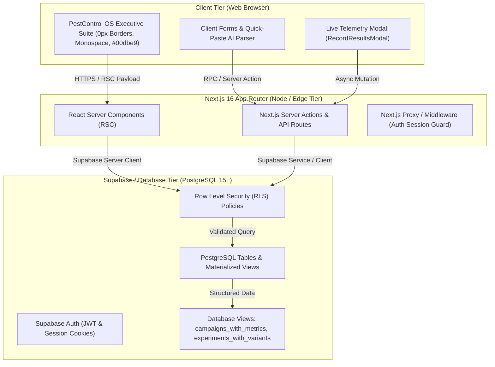
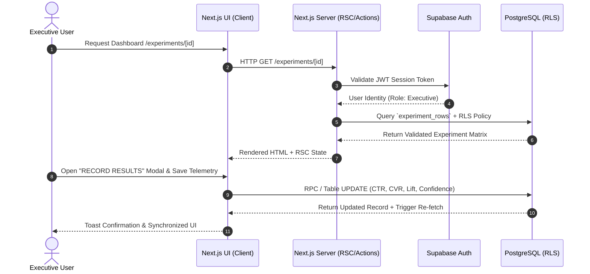

# Marketing Intelligence OS (MIOS) — Engineering Architecture

## 1. Executive Summary & Purpose
Marketing Intelligence OS (MIOS) is an enterprise-grade, internal operating system designed to transform ephemeral marketing campaign performance into permanent, compounding organizational knowledge.
Unlike traditional dashboards that only display historical metrics, MIOS enforces an engineering-driven feedback loop:
`Hypothesis -> Campaign Execution -> Observed Telemetry -> Statistical Validation -> Persistent Organizational Learning`

## 2. High-Level Architectural Design
MIOS uses a modern serverless, edge-optimized architecture built around Next.js App Router (React Server Components + Client Components) and Supabase (PostgreSQL, Row Level Security, and real-time subscription pipelines).

## 3. Core Design Principles & Tradeoffs
1. **Server-First Data Fetching vs. Client Reactivity**:
   - *Decision*: Core page layouts and initial data reads are handled via React Server Components (`@/lib/supabase/server.ts`), while interactive mutations (crud, telemetry recording, live calculators) use Client Components (`'use client'`) with optimistic updates.
   - *Why*: Minimizes client JavaScript bundle size and eliminates waterfall network requests while preserving instantaneous UX feedback for data entry.
2. **Zero-Emoji Executive Aesthetics**:
   - *Decision*: Strict adherence to a 0px border-radius (`rounded-none`), deep `#000000` dark mode palette, `#00dbe9` neon turquoise accent indicators, and monospace uppercase typography.
   - *Why*: Reduces cognitive clutter and elevates the interface from a standard web app to a mission-critical operating system for executive decision making.
3. **Automated Statistical Matrix Synchronization**:
   - *Decision*: A/B and Multivariate experiments recalculate lift and statistical confidence both on the client preview and upon persistence to the database.
   - *Why*: Ensures executives can evaluate test significance without leaving the workflow or relying on external spreadsheets.

## 4. Module Responsibilities & System Topography
- `@/app/(auth)`: Authentication boundaries, login card, and session initialization.
- `@/app/(dashboard)`: Authenticated shell layout containing vertical slices:
  - `/campaigns`: Campaign registry, performance telemetry, and hypothesis tracking.
  - `/creatives`: Creative asset library with AI Quick-Paste performance parsing.
  - `/experiments`: Scientific testing protocols (A/B, Multivariate), traffic split matrices, and live telemetry entry.
  - `/learnings`: Compounding organizational knowledge base derived from validated experiments.
- `@/components/layout`: AppShell, Executive Navigation Sidebar, and status command headers.
- `@/lib/supabase`: Typed client (`client.ts`) and server (`server.ts`) Supabase SDK instantiations.

## 5. Request & Lifecycle Flow

## 6. Future Architectural Improvements
- **Edge LLM Endpoint Integration**: Replace regex/heuristic parsing in AI Quick-Paste with a dedicated edge-hosted LLM worker for unstructured agency email summaries.
- **Real-Time Webhook Pipeline**: Stream ad platform spend and conversion metrics directly from Meta Marketing API and Google Ads API into `campaigns_with_metrics`.
