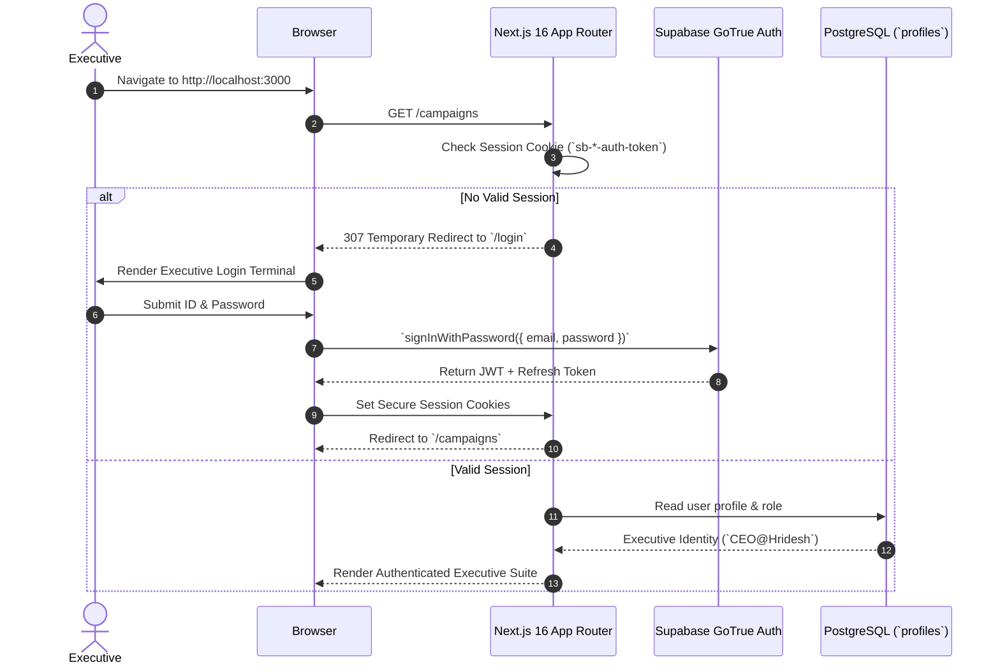

# Marketing Intelligence OS (MIOS) — Authentication Architecture

## 1. Executive Summary & Purpose
MIOS uses Supabase Authentication (GoTrue / JWT-based authentication) with HTTP-only session cookies to verify identity.
The system is designed for internal organizational access, meaning self-service public signups are disabled in production.

## 2. Authentication Flow Diagram

## 3. Executive Credentials & Identity
- **Primary Executive Account**:
  - *User ID*: `CEO@Hridesh` (or associated email `ceo@hridesh.com`)
  - *Role*: `CEO` (Full administrative override)
- **Session Duration**: Secure JWT access tokens expire after 3600 seconds (1 hour) with automatic background token rotation via refresh tokens.

## 4. Session Protection & Middleware Guard
- **Middleware Proxy (`@/middleware.ts` or Proxy handler)**:
  - Intercepts all incoming requests to protected routes (`/campaigns`, `/creatives`, `/experiments`, `/learnings`).
  - Verifies session token validity without calling database queries.
  - Redirects unauthenticated traffic to `/login`.

## 5. Security Best Practices
- Passwords are never stored in plain text; Supabase hashes credentials using bcrypt / Argon2.
- Session tokens are stored in secure, SameSite cookies to protect against Cross-Site Scripting (XSS) token theft.
