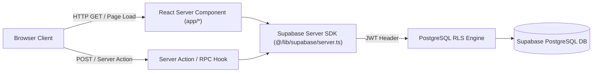

# Marketing Intelligence OS (MIOS) — Backend & Node/Edge Architecture

## 1. Executive Summary & Purpose
The backend of MIOS is implemented natively within Next.js 16 App Router using React Server Components (RSC), Server Actions, and Supabase Server SDK integrations.
This design removes the need for an external Express/Django backend service while maintaining strict server-side authentication, database query optimization, and Row Level Security (RLS) enforcement.

## 2. Backend Topography & Layering

## 3. Core Server Components & Libraries

### 3.1 `@/lib/supabase/server.ts`
- **Purpose**: Creates an asynchronous, server-side Supabase client that reads and writes authenticated HTTP cookies.
- **Implementation**: Uses `@supabase/ssr` with `cookies()` from `next/headers`.
- **Security Guarantee**: Never exposes service role secret keys to the browser; uses the Project URL and Anon key while relying on JWT cookies for user authorization.

### 3.2 Server-Side Data Fetching (RSC Pages)
- **Pattern**: Server pages (e.g., `/campaigns/[id]/page.tsx`, `/experiments/[id]/page.tsx`) perform async data reads directly on the server before emitting HTML.
- **Why**:
  - Eliminates client-side spinner waterfalls.
  - Prevents sensitive business logic or intermediate queries from leaking to the network tab.

### 3.3 Statistical & Mathematical Backend Rules
- All performance calculations are executed either within PostgreSQL views (`campaigns_with_metrics`) or through verified statistical utility helpers:
  - **Lift Formula**: `lift = ((variant_cvr - control_cvr) / control_cvr) * 100`
  - **Confidence Estimation**: Based on total conversion sample sizes (`total_conv >= 300` -> 95%+ significance tier; `< 150` -> directional testing tier).

## 4. Error Logging & Auditability
- Database write errors (e.g., RLS violations, unique constraint errors) are intercepted in Server Actions and converted into sanitized client error messages.
- Modifications to experiments automatically append timestamped audit strings (`> [SYNC YYYY-MM-DD HH:MM] ...`) into the `decision_protocol_notes` array.
