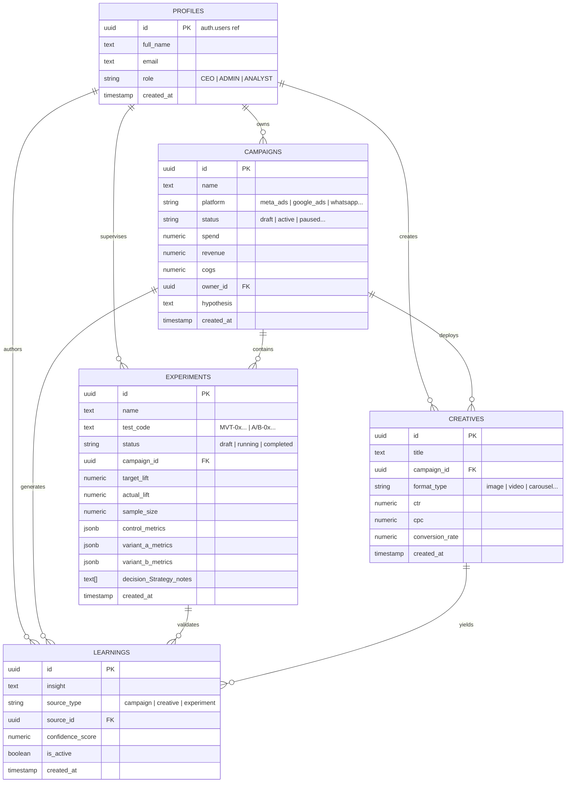

# Marketing Intelligence OS (MIOS) — Database Architecture

## 1. Executive Summary & Purpose
The MIOS database is a Supabase-managed PostgreSQL 15+ database structured around five primary entities: Profiles, Campaigns, Creatives, Experiments, and Learnings.
The schema enforces strong typing, auditability, and mathematical consistency between raw marketing input and calculated efficiency ratios.

## 2. Entity-Relationship (ER) Diagram

## 3. Core Tables & Rationale

### 3.1 `profiles`
- **Purpose**: Maps Supabase Authentication identities (`auth.users`) to organizational roles (`CEO`, `ADMIN`, `ANALYST`) and profiles.
- **Constraints**: Primary key references `auth.users(id)` ON DELETE CASCADE.

### 3.2 `campaigns`
- **Purpose**: Stores marketing campaign records, targeting parameters, financial spend, revenue, COGS, and reflection summaries.
- **Why**: Acts as the root entity for all marketing Metrics and ROI calculations.
- **Indexes**: `idx_campaigns_status_platform` on `(status, platform)`, `idx_campaigns_owner` on `(owner_id)`.

### 3.3 `creatives`
- **Purpose**: Tracks individual marketing assets (images, videos, copy variations) deployed within campaigns and their standalone CTR/CPC metrics.
- **Why**: Allows isolating performance down to the creative format and headline syntax.
- **Foreign Keys**: `campaign_id REFERENCES campaigns(id) ON DELETE SET NULL`.

### 3.4 `experiments`
- **Purpose**: Manages structured A/B and Multivariate scientific testing Strategys, including traffic split, runtime hours, and statistical comparison matrices.
- **Why**: Transforms marketing guesses into testable hypotheses with strict confidence thresholds.
- **Key Columns**:
  - `control_metrics`, `variant_a_metrics`, `variant_b_metrics` (`jsonb`): Stores `{ ctr, cvr, conversions }` objects for live Metrics recording.
  - `decision_Strategy_notes` (`text[]`): Timestamped Metrics logs and executive sync notes.

### 3.5 `learnings`
- **Purpose**: Stores compounding, immutable organizational insights derived from verified experiments and high-performing campaigns.
- **Why**: Ensures future campaigns do not repeat historical mistakes and leverage proven vectors.
- **Indexes**: `idx_learnings_source` on `(source_type, source_id)`, `idx_learnings_confidence` on `(confidence_score DESC)`.

## 4. Calculated Database Views

### 4.1 `campaigns_with_metrics`
- **Definition**: A SQL view that wraps `campaigns` and automatically computes financial efficiency ratios:
  - `ctr = (clicks / NULLIF(impressions, 0)) * 100`
  - `cpc = spend / NULLIF(clicks, 0)`
  - `cpl = spend / NULLIF(qualified_leads, 0)`
  - `cac = spend / NULLIF(customers_won, 0)`
  - `roas = revenue / NULLIF(spend, 0)`
  - `gross_profit = revenue - cogs`
  - `net_profit = (revenue - cogs) - spend`
  - `conversion_rate = (customers_won / NULLIF(qualified_leads, 0)) * 100`
- **Why**: Ensures all business logic rules are evaluated identically across all API endpoints and BI tools.

## 5. Security & Row Level Security (RLS)
- All tables have **Row Level Security (RLS)** enabled by default.
- Authenticated users with valid session tokens can read organizational records.
- Write/Update operations require authenticated user sessions matching owner credentials or executive role authorization.
