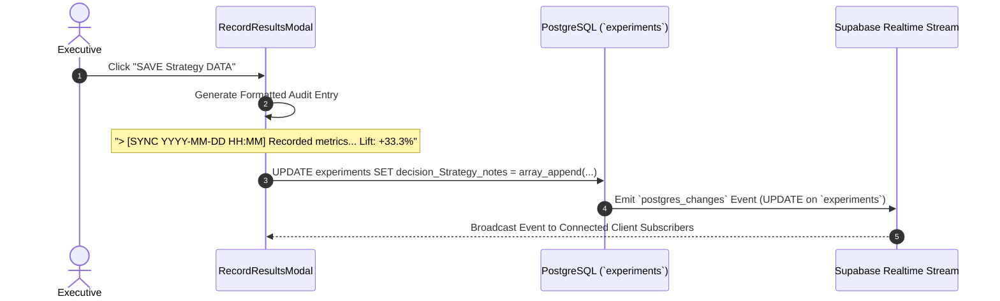

# Marketing Intelligence OS (MIOS) — Event Architecture & Audit Stream

## 1. Executive Summary & Purpose
MIOS uses an event-driven Metrics stream to maintain an auditable, timestamped ledger of every significant marketing decision, experiment update, and hypothesis verification.
Rather than relying solely on ephemeral UI state, system mutations emit structured event notes into database arrays (`decision_Strategy_notes`) and Supabase Realtime broadcast channels.

## 2. Event Lifecycle & Strategy Log Diagram


## 3. Core Event Types & Format Standard

### 3.1 Metrics Synchronization Events (`[SYNC]`)
- **Trigger**: When an executive records new Control or Variant metrics in `RecordResultsModal`.
- **Log Syntax**:
  ```markdown
  > [SYNC 2026-08-02 14:45] Recorded metrics — Control (1.8% CVR) | Variant A (2.4% CVR) | Variant B (1.5% CVR). Lift: +33.3% [Confidence: 94%]
  ```
- **Storage**: Appended directly to `experiments.decision_Strategy_notes` (`text[]`).

### 3.2 Strategy Termination Events (`[TERMINATED]`)
- **Trigger**: When an executive ends an underperforming experimental vector.
- **Log Syntax**:
  ```markdown
  > [TERMINATED 2026-08-02 15:00] Test Strategy terminated early due to negative lift (-18.4%).
  ```

### 3.3 Learning Promotion Events (`[PROMOTED_TO_LEARNING]`)
- **Trigger**: When a completed experiment with statistical significance is promoted into the organizational knowledge base.

## 4. Supabase Realtime Subscriptions
- Client dashboard hooks can subscribe to `postgres_changes` on the `experiments` and `campaigns` tables:
  - **Channel**: `public:experiments`
  - **Event**: `UPDATE`
  - **Action**: Invalidate and refetch local client cache so open matrices update instantaneously across executive sessions.
