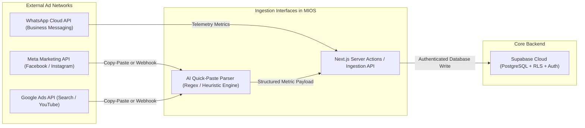

# Marketing Intelligence OS (MIOS) — External Integrations & Data Ingestion

## 1. Executive Summary & Integration Architecture
MIOS integrates with external advertising networks and database cloud providers to ingest performance metrics and authenticate organizational users.
While direct programmatic webhook ingestion is supported, MIOS also provides a resilient **AI Quick-Paste** manual ingestion bridge for agency reports and unstructured email summaries.

## 2. Integration Architecture Diagram

## 3. Supported Platform Connectors (`PlatformType`)

### 3.1 `meta_ads`
- **Scope**: Facebook Ads, Instagram Ads, Meta Audience Network.
- **Key Metrics Ingested**: Spend (`₹`), Impressions, Link Clicks, Lead Form Submissions, Cost Per Lead (CPL), and CTR.

### 3.2 `google_ads`
- **Scope**: Google Search, Performance Max, YouTube Ads.
- **Key Metrics Ingested**: Spend (`₹`), Search Impressions, Clicks, Qualified Leads, and CPC.

### 3.3 `whatsapp`
- **Scope**: WhatsApp Business Messaging & Direct Conversation campaigns.
- **Key Metrics Ingested**: Message Starts, Quote Requests, and Customer Conversions.

## 4. The AI Quick-Paste Ingestion Bridge
- **Why It Exists**: Advertising agencies frequently deliver campaign performance updates via unstructured email text or spreadsheets rather than direct API connections.
- **How It Works**:
  1. The executive pastes a raw text dump into the `/creatives/new` or `/campaigns/new` Quick-Paste area.
  2. The parser scans the text for currency markers (`₹`, `$`), percentage signs (`%`), and keyword identifiers (`Spend`, `CTR`, `CPC`, `Impressions`).
  3. Form input fields are populated automatically, saving manual data-entry time and reducing typo risks.
