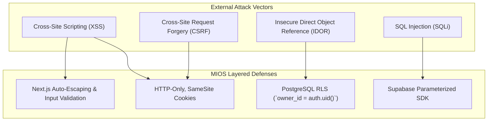

# Marketing Intelligence OS (MIOS) — Security Architecture & Threat Mitigation

## 1. Executive Summary & Security Posture
MIOS is an internal operating system handling confidential executive financial metrics, marketing spend, and proprietary testing protocols.
The security architecture enforces layered defense: secure session authentication, database-enforced Row Level Security (RLS), and zero-trust API validation.

## 2. Threat Vector Analysis & Mitigations

## 3. Core Security Defenses

### 3.1 Row Level Security (RLS) as Primary Boundary
- **Defense against IDOR**: Even if an unauthorized user attempts to call `GET /api/campaigns/<uuid>`, PostgreSQL RLS intercepts the query and checks `auth.uid()`.
- **Policy Enforcement**: All tables (`campaigns`, `creatives`, `experiments`, `learnings`) deny public reads and writes by default.

### 3.2 Cookie & Session Protection
- **Defense against XSS**: JWT tokens are managed by `@supabase/ssr` via server-side cookies rather than client `localStorage`.
- **SameSite Policy**: Cookies use `SameSite=Lax` or `Strict` to prevent CSRF token hijacking from external malicious domains.

### 3.3 Input Sanitization & SQLi Protection
- **Defense against SQLi**: Never concatenate raw user input into SQL queries. All database operations execute through Supabase's parameterized PostgreSQL client SDK.
- **AI Quick-Paste Protection**: The heuristic parser regex-strips executable scripts or HTML tags before mapping clipboard text into numeric form fields.
