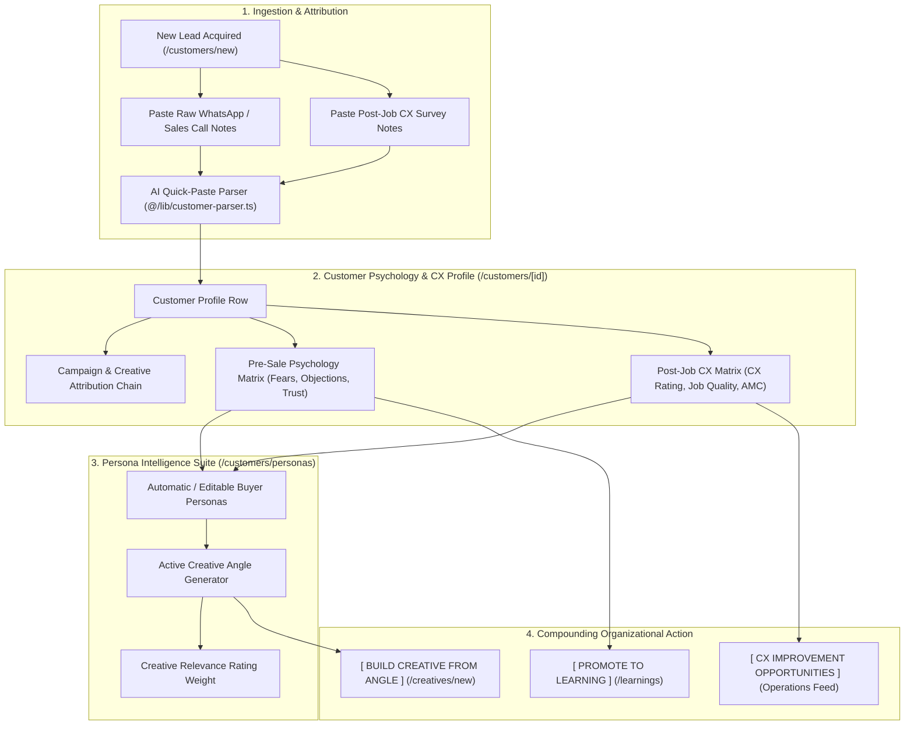

# Marketing Intelligence OS (MIOS) — UX Research & UI Implementation Hypothesis: Customer Profiles & Buyer Personas

## 1. Executive Summary & Core Objective
In conventional SaaS tools, "Buyer Personas" are static documents that do not interact with advertising campaigns or field operations.
In MIOS, **Customer Profiles & Buyer Personas** serve as an active, bidirectional intelligence engine:
1. **Pre-Sale Consumer Psychology**: Why did they contact us? What was their #1 fear and objection? What built trust?
2. **Post-Job CX & Operational Feedback**: What was their 1–5 CX rating? What will improve our job quality on-site? What Annual Maintenance Contract (AMC) or referral opportunities exist?
3. **Active Creative Library Collaboration**: Personas systematically analyze customer fears and objections to generate high-converting **Creative Angle Recommendations** (Hook, Emotion, Psychological Principle) that feed directly into `/creatives/new`.

---

## 2. Executive Workflow Mapping & Persona Journey

---

## 3. Formal UI Implementation Hypothesis

### The Scientific Hypothesis
> **We believe that** combining individual customer psychological profiles and post-job CX feedback into **Active Buyer Personas that directly recommend and rate ad creative angles** for our marketing and sales executives  
> **will achieve** a **+25% increase in creative CTR and higher repeat AMC conversion**  
> **as measured by** creative efficiency ratings, customer lifetime value (LTV), and reduction in post-job operational complaints.

### Key UX Design Interventions
1. **Widescreen 2-Column Customer Detail View (`/customers/[id]`)**:
   - *Left Column (Economics & Attribution)*: Financial ratios (`Revenue`, `Profit`, `LTV`) and clickable attribution links (`Campaign` → `Creative`).
   - *Right Column (Psychology & CX Gold Mine)*: Distinct terminal cards for Pre-Sale Psychology (`Why Contacted`, `Biggest Fear`, `Biggest Objection`, `Why Chose Us`) and Post-Job CX (`CX Score 1-5`, `Job Quality Feedback`, `Improvement Opportunities`).
   - *Action Bar*: High-contrast **`[ PROMOTE TO LEARNING ]`** and **`[ LOG AMC OPPORTUNITY ]`** terminal buttons.
2. **Active Persona Cards with Creative Collaborator (`/customers/personas`)**:
   - Displays aggregated cluster metrics (`Sample Size`, `Avg LTV`, `Avg CX Rating`).
   - **Active Creative Angles Panel**: Systematically lists 3 recommended creative angles (Hook, Emotion, Rationale) derived from the Persona's #1 Fear and Objection.
   - **`[ BUILD CREATIVE FROM ANGLE ]`** button that pre-populates `/creatives/new` with the recommended Hook, Headline, and Psychological Principle.
3. **Unified AI Quick-Paste Box**:
   - A single multi-purpose paste box that accepts WhatsApp customer chats, sales calls, OR post-job technician debriefs and maps them into both Pre-Sale and Post-Job CX fields.
